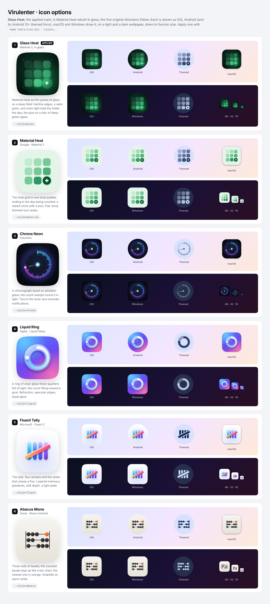

<div align="center">

# Virulenter

**Tap to count. Every press is a data point.**

An offline-first counter that keeps a timestamped log of every tap —
so you get both the running total and the *when*.

**Web** · **Android** · **Windows** · **macOS** · **Linux**

`no account` · `no server` · `your data stays yours`

</div>

---

## Contents

- [What it is](#what-it-is)
- [Downloads](#downloads)
- [Quick start](#quick-start)
- [Native app — Android, Windows, macOS, Linux](#native-app--android-windows-macos-linux)
- [Android APK (web wrapper)](#android-apk-web-wrapper)
- [Installing on a phone](#installing-on-a-phone)
- [Testing on the web and on Android](#testing-on-the-web-and-on-android)
- [How your data is stored](#how-your-data-is-stored)
- [Features](#features)
- [Exporting](#exporting)
- [Appearance](#appearance)
- [App icon](#app-icon)
- [Project layout](#project-layout)
- [Commands](#commands)
- [Architecture](#architecture)
- [Verification](#verification)
- [Limitations](#limitations)
- [Browser support](#browser-support)

---

## What it is

Create an event — *Coffee*, *Workout*, *Cigarettes*, *Times I called home* — and
press its button every time it happens. Virulenter adds one to the total and
records the exact time.

Two questions get answered from the same data:

| Question | Where |
|---|---|
| *How many so far?* | the big number on each card |
| *When did they happen?* | the calendar heat grid and the statistics view |

Nothing is sent anywhere. In the web app nothing is even written to the
browser: the complete session lives in the URL, so **the link is the save
file** — bookmark it, or open it on another device and everything is there.
The native app keeps the same data in one file on the device, and moves it to
and from the web app through backups and links.

| | |
|---|---|
| **Web app** (`app/`) | plain HTML/CSS/JS; installable as a PWA, or a single file you just open |
| **Native app** (`native/`) | Kotlin Multiplatform + Compose: Android, Windows, macOS, Linux — with notifications, reminders, a live counter, a Quick Settings tile, a widget and a tray menu |
| **Android wrapper** (`apk/`) | the web app in a WebView, with no permissions at all |

## Downloads

Every file is built by GitHub Actions ([`release.yml`](.github/workflows/release.yml))
and attached to the release when a version tag is pushed — see
[RELEASE_NOTES.md](RELEASE_NOTES.md) for what is in 2.0.0:

| file | for |
|---|---|
| `virulenter-android.apk` | Android 8.0+, native app |
| `Virulenter-2.0.0.msi` | Windows 10/11 |
| `Virulenter-2.0.0.dmg` | macOS (Apple silicon and Intel builds come from the runner's architecture) |
| `virulenter_2.0.0-1_amd64.deb` | Debian, Ubuntu and derivatives |
| `virulenter.html` | any browser — the web app as one file, also kept in [`dist/`](dist/virulenter.html) |
| `virulenter-web-android.apk` | Android 7.0+, the web app wrapped |

To publish a release from this repository:

```bash
git tag v2.0.0
```

```bash
git push origin v2.0.0
```

Each push to a branch also runs the workflow and keeps the files as build
artifacts on the run's page, without publishing a release.

## Quick start

Two ways to run it. Both are complete; pick by how you want to use it.

### 1. Installable app — recommended

```bash
node tools/serve.mjs
```

It prints a local address and a LAN address:

```
  this machine   http://localhost:8080/
  phone / LAN    http://192.168.1.24:8080/
```

Open it, then use **Install** in the address bar (desktop) or **Share → Add to
Home Screen** (iOS). See [Installing on a phone](#installing-on-a-phone) for the
Wi-Fi, local-file and https routes side by side.

### 2. One file — nothing to install, nothing to host

**`dist/virulenter.html`** — a single self-contained file, ~290 KB. Send it by
email or chat, drop it on a USB stick or a shared drive, and double-click it.
No server, no build step, no network access of any kind: the audit confirms
zero external references, with the stylesheet, all eight scripts and the
favicon inlined.

Everything works this way. The only things it *cannot* do are the two that
require an HTTP origin by browser rule:

| | single file | served / installed |
|---|:--:|:--:|
| count, calendar, statistics, export, appearance | ✓ | ✓ |
| your log in the link, restored on reopen | ✓ | ✓ |
| install to home screen / Dock | — | ✓ |
| offline via service worker | — | ✓ |

Those two need a hosted copy because service workers and install prompts are
unavailable over `file://`. Opening the file directly still works offline in
the ordinary sense — a local file needs no network to load.

> A note for whoever receives it: some chat and mail clients rename attachments
> or hand them over without the `.html` extension. If double-clicking opens a
> text editor instead of a browser, rename it to `virulenter.html` first.

## Native app — Android, Windows, macOS, Linux

[`native/`](native/README.md) is Virulenter written once in Kotlin Multiplatform
with Compose Multiplatform, and native on each platform:

- **Live counter** — Android: an ongoing notification with today's count, a
  clock running from the last tap, **+1** and **Undo**, and goal progress.
  Desktop: an always-on-top mini counter window.
- **Reminders** — daily per event on chosen weekdays; on Android through
  `AlarmManager` (exact once allowed, re-armed after reboots), with a **+1**
  button in the notification; on desktop while the app runs in the tray.
- **Count without opening the app** — Quick Settings tile, home-screen widget
  with a live clock, launcher shortcuts; on desktop a tray menu and Ctrl/⌘ 1–9.
- **Goals**, the calendar heat grid, the statistics dashboard with interactive
  charts, appearance, import/export and undo — shared by every platform.
- A glass material with real backdrop blur, grain and lit rims; tight corners.

Data moves both ways with the web app: import a web link, a data code or a JSON
backup; copy a data code back. The link codec is a byte-exact port of
`app/js/codec.js`, tested against payloads produced by the web app.

```bash
cd native && ./gradlew :composeApp:run        # desktop, from source
```

```bash
cd native && ./gradlew :composeApp:assembleRelease   # Android APK
```

Building, packaging (`.msi`, `.dmg`, `.deb`), tests and the layout are in
[`native/README.md`](native/README.md).

## Android APK (web wrapper)

The web app, wrapped for Android. `node tools/build-apk.mjs --release` builds it
(the first run provisions the toolchain), and the release workflow attaches it
to each release as `virulenter-web-android.apk`. It is signed and zip-aligned,
so it installs by tapping it — no developer tools, no cable, no command line on
the phone.

> `dist/virulenter-android-release.apk` and `-debug.apk` are the builds from
> v0.0.1 and still show the original interface; build a fresh one, or take it
> from a release.

### Getting it onto the phone

```bash
node tools/share-apk.mjs
```

That serves the APK over your local network behind a small page with a **QR
code**. Point the phone camera at it, tap the link, tap **Download**, open the
file, allow installs from this source once, and you are done. The page also
carries the plain URL for typing, and a link to the web build for a computer.

No QR encoder present? The page says so and shows the URL instead — the server
works either way, and nothing depends on it. To get the QR, install OpenCV once
(it is only needed to draw the code, never to build or run the app):

```bash
pip install --target .toolchain/pylibs opencv-python-headless
```

Other routes, if you prefer:

| route | how |
|---|---|
| **USB** | `adb install -r dist/virulenter-android-release.apk` |
| **Cloud drive** | upload the APK, download it on the phone, tap it |
| **Chat / email** | send the file to yourself and open it on the phone |
| **Direct** | copy to the phone's storage over USB, open with a file manager |

Android will warn about installing from an unknown source, because the app is
not distributed through Play. That prompt is expected.

It is a thin wrapper, not a second implementation: the same `app/` files are
bundled into the APK and served to a WebView through `WebViewAssetLoader` on the
virtual origin `https://appassets.androidplatform.net/`. That origin matters —
the app's entire persistence model is the URL fragment, and a `file://` page has
an opaque origin where `history.replaceState` throws.

| | |
|---|---|
| **minSdk** | 24 (Android 7.0) |
| **targetSdk** | 35 |
| **permissions** | none — not even `INTERNET` |
| **offline** | fully; the assets are in the APK |
| **exports** | CSV/JSON go to Downloads, or out through a share sheet |
| **install** | `node tools/share-apk.mjs` → scan the QR |
| **survives being backgrounded** | yes — the session URL is snapshotted to private storage on every change |
| **icon** | adaptive (fits any launcher shape) and themed — Android 13+ tints it with the wallpaper |
| **dark mode** | follows the phone; the status and navigation bars switch with it |
| **debug builds** | inspectable live from `chrome://inspect` — see [Testing](#testing-on-the-web-and-on-android) |
| **rebuild** | `node tools/build-apk.mjs` |

The absence of the `INTERNET` permission is deliberate and verified: the web
layer never makes a request, and leaving the permission out makes Android
enforce that rather than trusting it.

[`apk/README.md`](apk/README.md) covers the build, the toolchain matrix, signing
and the architecture. Nothing is reimplemented — the web layer detects the
native bridge per call, so the browser and APK builds stay one codebase.

## Installing on a phone

Without the APK, the rule that decides everything is: **browsers only install an
app from a secure origin.** `https://` and `http://localhost` count. `file://`
and plain `http://` to a LAN IP do not. That produces four cases.

### A. Phone on the same Wi-Fi as your computer — quickest

```bash
node tools/serve.mjs            # prints a LAN address, e.g. http://192.168.1.24:8080/
```

Open that address on the phone:

| Phone | Steps | Get offline? |
|---|---|---|
| **Android** | menu → *Add to Home screen* | no — needs https (case C) |
| **iPhone** | Safari → Share → *Add to Home Screen* | no — needs https (case C) |

You get a real home-screen icon and a standalone window; the app just needs the
computer to be reachable. Both phones will say so in **Settings → Install**.

### B. Just want it on the phone, no computer involved

Send yourself `dist/virulenter.html` and open it from Files / Downloads. It works
fully — counting, calendar, statistics, export — and each tap still writes the
log into the address bar, so **bookmarking that URL keeps your data**.

It cannot be installed from a local file, and the app states this plainly rather
than showing a button that does nothing.

### C. Properly installed with offline support — needs https

Put `app/` on any static host. No build step, no server-side code:

- **GitHub Pages** — commit `app/` to a repo, Settings → Pages
- **Netlify Drop** — drag the `app` folder onto the page, get a URL immediately
- **Cloudflare Pages / Vercel / Surge** — same idea

Then open the https URL on the phone and install:

| Platform | Action | Result |
|---|---|---|
| **iOS / iPadOS** | Share → *Add to Home Screen* | icon, standalone window, **offline** |
| **Android** | menu → *Install app* | app drawer entry, **offline** |
| **Chrome / Edge (desktop)** | install icon in the address bar | own window, **offline** |
| **Safari (macOS)** | File → *Add to Dock* | Dock app |
| **Firefox** | no install UI | runs as a normal web app |

Installation is verified in the test suite over HTTP: the manifest and all five
icons load, the worker registers and pre-caches the 19-file shell, and an
offline reload served entirely from cache is checked with
`Network.emulateNetworkConditions`.

### D. Already installed

The install row disappears once the app is running in standalone mode.

## Testing on the web and on Android

### On the web

| What | How |
|---|---|
| Run it | `node tools/serve.mjs`, then open `http://localhost:8080/` |
| On a phone on the same Wi-Fi | open the LAN address it prints, e.g. `http://192.168.1.24:8080/` |
| With no server at all | double-click `dist/virulenter.html` |
| Phone sizes on a computer | Chrome DevTools → device toolbar (⌘⇧M / Ctrl+Shift+M) |
| Dark mode, reduced motion, reduced transparency | DevTools → ⋮ → More tools → **Rendering** → *Emulate CSS media feature* |
| The automated suites | `node tools/verify.mjs` — and the two variants in [Verification](#verification) |
| Every screen, both themes | `node tools/shots.mjs` writes them to `verify/shots/` |

Worth trying by hand: tap a card and watch the count, the sparkline and the
summary move; remove a tap in the calendar and press **Undo**; in **Stats**, hover
or tap a column, drag a finger across a chart, use the arrow keys and Enter,
switch **7D / 30D / 90D / 1Y**, pick one event, and open the table view (the grid
icon); in **Settings → Appearance**, switch to Dark and try a custom colour.

### On Android

1. **Build** — `node tools/build-apk.mjs` for a debug APK, `--release` for the
   signed one. The first run provisions the JDK, Gradle and the Android SDK
   (about 900 MB); the provisioning scripts fetch macOS builds of the tools.
2. **Install** — `node tools/share-apk.mjs` and scan the QR code with the
   phone, or over USB: `adb install -r dist/virulenter-android-debug.apk`.
3. **Inspect** — a debug build switches on WebView debugging. With the phone on
   USB (and USB debugging on), open `chrome://inspect` on the computer and press
   *inspect* under Virulenter: the full DevTools, attached to the running app.
4. **Check** — the launcher icon in your launcher's shape, and as a themed icon
   (Settings → Wallpaper & style → Themed icons, Android 13+); dark mode, with
   the system bars following; the back button closing one sheet at a time; a
   CSV export landing in Downloads; and that the log survives the app being
   swiped away and reopened.

No build at hand? Open the LAN address in Chrome on the phone and use ⋮ →
*Add to Home screen* — the same app, minus the native file saving.

### The native app

| What | How |
|---|---|
| Desktop, from source | `cd native && ./gradlew :composeApp:run` |
| Android | `./gradlew :composeApp:assembleDebug`, then `adb install -r composeApp/build/outputs/apk/debug/composeApp-debug.apk` |
| Shared-code tests | `./gradlew :composeApp:desktopTest` |
| Without building | take the APK and installers from a release (see [Downloads](#downloads)) |

Worth trying by hand on Android: turn on **Settings → Live notification** and
pull down the shade — the clock runs from your last tap, **+1** counts without
opening the app; give an event a **daily reminder** a minute or two ahead and
lock the phone; add the **Count +1** tile in Quick Settings and the **widget** on
the home screen; long-press the app icon for the "+1" shortcuts; set a **daily
goal** and reach it. On desktop: count from the **tray menu** and with
**Ctrl/⌘ 1–9**, open the **mini counter** (View menu), close the window and let
a reminder arrive from the tray. Then import a web link in **Settings → Import**,
and paste **Copy data code** into the web app.

## How your data is stored

This is the part that shapes everything else.

There is **no `localStorage`, no `sessionStorage`, no IndexedDB, no cookies, and
no server.** Every change rewrites the address bar via `history.replaceState`,
so the link you can see is always the current session.

```
https://example.com/virulenter/#d=AgEEQ29mZmVlApARAagIsuwB
```

- **Every session rides in the `#` fragment.** A fragment is never sent to the
  server, so its length is limited only by the browser — whereas a long `?d=`
  query makes a reload fail with *414 URI Too Long* on most hosts.
- **Two links merge** — repeat `&d=…` and the app unions them by event id, so
  there is no hard ceiling. A `?d=` link and a `#d=` fragment merge too, both
  on load and when pasted into *Settings → Paste data*.
- **Backups** — JSON for exact restore, CSV for spreadsheets.

### Payload format

A packed binary blob, base64url-encoded. Each tap is stored as *(day offset,
minute of day)* rather than a raw epoch timestamp: taps sit within a few hours
of local midnight, so the minute part fits in two bytes.

| taps | link length | |
|---:|---:|---|
| 1 | 96 | |
| 100 | 762 | |
| 250 | 1 763 | |
| **~280** | **~2 000** | `MAX_URL`: the longest link that is safe to paste into chat or mail |
| 365 (a year of daily taps) | 2 530 | still saved in the address bar |
| 2 000 | 13 203 | still saved in the address bar |
| **~4 800** | **~32 000** | `MAX_BAR`: the address bar stops updating |

Two limits, for two different jobs. Past `MAX_URL` (2 000 characters) chat apps
and mail clients start truncating links, so *Settings* suggests moving the data
as a backup file instead — but the address bar keeps saving every tap. Only past
`MAX_BAR` (32 000 characters, far inside every browser's limit and small enough
for Android's saved-state bundle) does the app stop rewriting the bar, and then
it says so on screen and points you at the backup.

A JSON timestamp costs ~17 base64 characters; this format costs ~2.7. That 6×
is the difference between holding a year and holding six weeks.

## Features

### Counting
- Create any number of events, each with a name, colour, and a start date.
- One press = **+1** and a timestamp. Presses are recorded to the minute.
- Per-card figures: total, average per day, first tap, days running, last tap.
- Correct English pluralisation (*1 tap* / *3 taps*).
- Remove a mistaken press individually, or clear an event's history — both
  with **Undo**, as is deleting an event.
- In-place updates on tap, so the list never reorders under your finger.
- Each card shows its **last seven days** as a sparkline, in the event's colour.
- Destructive actions ask first, in an in-page dialog that also works inside
  the Android app (which answers `window.confirm()` with an instant *no*).

### Calendar
- Monday-first month grid; each day shaded by how many taps landed on it. The
  intensity scale is derived from your own data, so it stays readable whether
  you tap three times a week or forty times a day.
- **Quick jump** — tap the month title for a 12-month picker with per-month
  counts, plus a list of the years that actually contain data.
- **Previous year / `Today` / next year** buttons for fast travel, and a
  sideways swipe on the grid to change month.
- **Year at a glance**: a row per month and a column per day, so a whole year
  fits the width of a phone — every day visible, each cell clickable.
- Tap a day to list its taps with times, or delete one. Add a tap to a past day
  for **the event you pick, at the time you set**; days still ahead cannot be
  logged.

### Statistics
- **One filter row** scopes every figure on the page, so the numbers always
  agree: the range (7 days, 30 days, 13 weeks, 12 months), then one event or all
  of them. It stays pinned under the top bar while you scroll.
- **Stat tiles**: taps in the range — the one hero figure — average per day and
  active days, each with its change against the period before; the current
  streak and the best.
- **Taps per day, week or month**: columns on a hairline grid with round-number
  ticks, a dashed line at the average, and only the peak labelled.
- **By weekday and by hour**: the busiest column in the accent, the rest
  receding — the finding, at a glance.
- **Interactive throughout**: hover or tap a column for a tooltip that leads
  with the value and splits it by event; drag a finger to scrub; use the arrow
  keys and Enter; click — or tap again — to open that day, week or month in the
  calendar.
- **A table view** of every chart, one tap away, for exact numbers and screen
  readers.
- **Per event** (stacked into compact rows on a phone), **streaks** (all time),
  and a **53-week activity heatmap** with the same tooltips.

### Appearance
- **Frosted glass**: panes with backdrop blur, an acrylic grain and a 1px rim
  lit from the top left, over an aurora drawn from your accent, a fine light
  grid and one defined orb. Corners are tight (4–16px). Turn on *Reduce
  transparency* in the system settings and every surface goes solid.
- **Light, dark, or follow the system** — the system setting is tracked live.
- 10 accent presets plus an arbitrary custom colour (picker or hex).
- Choosing a colour re-tints the whole app, including the calendar and heat-grid
  ramps — the shades are derived from your accent, not hard-coded, and mixed
  against the active theme so every text colour keeps its contrast.
- 5 typefaces: System, Humanist, Serif, Rounded, Mono, each shown in its own face.
- Live preview card inside the sheet.
- Appearance is part of the payload, so the look travels with the link.

## Exporting

| Format | Contents | Use |
|---|---|---|
| **Every tap (CSV)** | one row per tap: event, date, time, year, month, day, weekday, unix timestamp | Excel, Numbers, Google Sheets, pandas |
| **Summary (CSV)** | one row per event: taps, share, average, active days, first/last tap, start date | reporting |
| **Backup (JSON)** | full state including ids and appearance | exact round-trip restore |

CSV follows RFC 4180: fields containing commas, quotes or newlines are quoted,
and embedded quotes are doubled. Rows are CRLF-terminated, so files open cleanly
in spreadsheet software.

## App icon

**Glass Heat** — the calendar's heat grid as thin panes of glass on a deep,
smooth green field. Nothing reflects: each pane is a flat sheet with a hairline
edge and a fine satin grain, tinted by the day's heat — the coolest nearly
clear, the hottest holding mint light that glows onto the field behind. The
plus sits on a disc of deep green glass inside a fine HUD ring, and slim
viewfinder brackets frame the grid.

It is Material Heat, chosen from the first five directions and rebuilt in
glass. All six are drawn for every platform — as iOS, Android (and its themed
form), macOS and Windows show them, on light and dark wallpapers
([docs/icons/index.html](docs/icons/index.html)):



| style | after | idea |
|---|---|---|
| **Glass Heat** *(applied)* | Material 3, in glass | the heat grid as thin glass panes — hairline edges, a satin grain, heat as held light |
| **Chrono Neon** | futuristic | a chronograph bezel on obsidian glass; the count sweeps round it in light |
| **Liquid Ring** | Apple · Liquid Glass | a clear glass ring three-quarters full of light |
| **Fluent Tally** | Microsoft · Fluent 2 | four strokes and the strike, luminous layered gradients |
| **Material Heat** | Google · Material 3 | the heat grid in one tonal palette, ending in a raised plus |
| **Abacus Mono** | Swiss · Braun | beads stepping up like a bar chart, the newest in orange |

```bash
node tools/icon.mjs --style=liquid     # apply one everywhere
```

```bash
node tools/icon.mjs --gallery          # redraw the comparison sheet
```

Applying a style redraws the web icons and the in-page mark, the iOS touch
icon, both Android projects' legacy, adaptive and themed layers, and the
desktop `.ico`, `.icns` and `.png`. The native app's notification icon, launcher
shortcut and widget button are drawn to match Glass Heat. Change `DEFAULT_STYLE` in
`tools/icon-styles.mjs` to make the choice stick.

## Project layout

```
virulenter/
├─ app/                     the application (serve this)
│  ├─ index.html
│  ├─ manifest.webmanifest  PWA manifest
│  ├─ sw.js                 service worker (offline shell)
│  ├─ css/
│  │  ├─ base.css           tokens, shell, controls, sheets
│  │  ├─ views.css          event cards, calendar, day panel
│  │  └─ stats.css          statistics view, charts, jump picker, appearance
│  ├─ js/
│  │  ├─ core.js            helpers, ordinal-day date maths
│  │  ├─ codec.js           the URL wire format: pack / unpack / merge
│  │  ├─ store.js           state, derived statistics, CSV, URL sync
│  │  ├─ ui.js              card and day-panel rendering, sheets
│  │  ├─ views.js           events list, calendar grid, intensity scale
│  │  ├─ charts.js          interactive SVG charts and the shared tooltip
│  │  ├─ stats.js           statistics dashboard, filters, heat grids
│  │  └─ app.js             bootstrap, routing, install flow, export
│  └─ icons/                generated icon set (SVG + PNG)
├─ native/                  native app, Kotlin Multiplatform (see native/README.md)
│  ├─ composeApp/src/       commonMain (model, UI), androidMain, desktopMain, tests
│  └─ gradlew               Gradle wrapper
├─ apk/                     Android web-wrapper project (see apk/README.md)
│  ├─ app/src/main/         manifest, java, res, and the synced web assets
│  ├─ build.gradle          pinned AGP 8.7.3
│  └─ gradlew               Gradle wrapper, so no system Gradle is needed
├─ dist/
│  ├─ virulenter.html               single-file web build
│  ├─ virulenter-android-release.apk   (v0.0.1, original interface)
│  └─ virulenter-android-debug.apk
├─ docs/icons/              the icon options, side by side
├─ .github/workflows/       release.yml: builds and publishes every file
├─ tools/
│  ├─ verify.mjs            89 automated checks in real headless Chrome
│  ├─ chrome.mjs            finds Chrome / Chromium for the headless tools
│  ├─ shots.mjs             regenerates verify/shots/*.png
│  ├─ icon.mjs              draws every icon: web, iOS, Android, Windows, macOS, Linux
│  ├─ icon-styles.mjs       the icon designs
│  ├─ serve.mjs             HTTP server for installing / phone testing
│  ├─ build-apk.mjs         provisions the toolchain and builds the APK
│  ├─ sync-android.mjs      copies app/ into the Android assets
│  ├─ share-apk.mjs         serves the APK over LAN with a QR code to scan
│  ├─ qr.mjs                makes the QR PNG (falls back gracefully)
│  ├─ fetch-sdk.mjs         installs the Android SDK without sdkmanager
│  └─ validate-apk.mjs      14 checks on a built APK
├─ build.mjs                inlines app/ into dist/virulenter.html
└─ verify/shots/            screenshots
```

## Commands

```bash
node tools/serve.mjs                 # serve app/ for install + LAN testing
node build.mjs                       # rebuild dist/virulenter.html
node build.mjs --min                 # minified variant
node tools/verify.mjs                # 89 checks, served over HTTP
node tools/verify.mjs --url=file://$PWD/dist/virulenter.html   # checks the single-file build
node tools/shots.mjs                 # regenerate screenshots
node tools/icon.mjs                  # regenerate icons (web, Android, desktop)
node tools/icon.mjs --style=fluent   # switch the icon style everywhere
node tools/icon.mjs --gallery        # redraw docs/icons/
node tools/build-apk.mjs             # build the Android APK (provisions on first run)
node tools/build-apk.mjs --release   # signed release APK
node tools/share-apk.mjs             # serve the APK + QR so a phone can install it
node tools/validate-apk.mjs dist/virulenter-android-release.apk
node tools/verify.mjs --root="$PWD/apk/app/src/main/assets"   # test the packaged assets
node tools/clean.mjs                 # reclaim build caches
cd native && ./gradlew :composeApp:desktopTest   # native: shared-code tests
cd native && ./gradlew :composeApp:run           # native: desktop app from source
```

The headless tools find Chrome or Chromium on macOS, Linux and Windows; set
`CHROME=/path/to/browser` to use a specific one.

### Keeping the checkout small

Building the APK needs a JDK, Gradle and the Android SDK — about 900 MB once
provisioned, and Gradle's dependency cache grows to several GB on top. All of it
is regenerable and none of it is source, so it can be removed whenever:

```bash
node tools/clean.mjs                 # caches and build output     (~4 GB)
node tools/clean.mjs --toolchain     # also the JDK, SDK, Gradle   (~14 GB)
node tools/clean.mjs --dry-run       # list first, delete nothing
```

`--toolchain` leaves a checkout that is pure source plus the built artifacts in
`dist/`. Rebuilding after that re-downloads the toolchain automatically:

```bash
node tools/build-apk.mjs --provision
```

Nothing under `dist/` is ever touched by the cleaner: the APKs and the
single-file web build are deliverables, not cache.

`sdk/emulator`, `sdk/ndk`, `sdk/system-images` and `platforms/android-36` are
**not** installed by this project's scripts and are not needed to build it, so
they are only removed with an explicit `--sdk-extras` flag — they may well
belong to other work.

## Architecture

**No dependencies, no framework, no bundler.** Plain classic `<script>` tags in
load order, so the single-file build is a literal inlining of the same files and
behaves identically — which is why one verification suite covers both.

```
core ─ codec ─ store ─ ui ─ views ─ charts ─ stats ─ app
```

- `core.js` — date arithmetic on **ordinal day numbers**. `Date.UTC(...)/86400000`
  mixes a UTC epoch with a local midnight and drifts by a day outside UTC, so
  dates are counted as whole days instead.
- `codec.js` — the wire format. Also derives accent tints from any colour, so a
  custom pick gets the same soft/ink/hover treatment as a preset.
- `store.js` — state plus every derived figure (streaks, distributions, CSV).
  Pure reads; nothing is cached in the browser.
- `ui.js` / `views.js` / `stats.js` — rendering only.
- `charts.js` — SVG column charts drawn at the container's real width, with the
  hover, touch, keyboard and table-view layers; one tooltip for every chart.
- `app.js` — wiring, routing, install flow, export.

Rendering is string-based and re-derived on change. At the scale a personal
counter reaches (hundreds of taps), rebuilding a list is far cheaper than
maintaining a diffing layer.

## Verification

All green:

| suite | scope | result |
|---|---|---|
| `tools/verify.mjs` | the web app in headless Chrome | **89 checks** |
| `tools/verify.mjs --url=file://…/dist/virulenter.html` | the single-file build | **87 checks** |
| `tools/verify.mjs --root=apk/app/src/main/assets` | the exact bytes packaged into the APK | **88 checks** |
| `tools/validate-apk.mjs` | the built APK itself | **14 checks** |
| `native: ./gradlew :composeApp:desktopTest` | the native app's shared code | **31 tests** |

The web suite drives the real application over CDP — covering:

- first run, empty state, form validation, event creation
- the increment: value, per-press timestamps, pluralisation, last-tap line
- **that `localStorage`, `sessionStorage` and `cookies` stay empty** — before,
  during and after a reload
- URL round-trip across a real reload
- calendar: grid shape, intensity classes, day panel, removing a tap, day totals
- both merge paths (repeated `?d=`, and `?d=` with `#d=`), corrupt-link handling
- long logs keep saving in the fragment; a log past the ceiling warns
- codec round-trips: Unicode names, month ends, a 365-tap year, exact tap times
- CSV: row count, RFC 4180 quoting, CRLF, both export shapes
- appearance: presets, fonts, custom colour — through the link and onto the ramp
- statistics: every panel, the range rebucketing (7 days / 13 weeks / 12
  months), streak and per-event figures, the heat grid
- charts: the keyboard path from a column to the calendar, tooltips that split
  a value by event, the event filter rescoping every figure, table views
- calendar jump picker and the year strip
- PWA: manifest contents and icon fetches, worker registration and pre-cache,
  and **an offline reload** with `Network.emulateNetworkConditions`
- XSS escaping of user text in every render path
- layout on a 360px phone and on a wide screen: nothing widens the page, no
  label or figure is clipped, nothing floats over the controls, and sheets
  stack in the order they were opened
- the theme, in-page confirmations, Undo, and merging a backup into itself
- the glass material — frosted panes, lit rims, tight corners — and its
  turning solid under *reduce transparency*, and the iOS touch icon
  being a full-bleed square (iOS rounds it; a pre-rounded one showed dark
  corners)

The APK validator reads the built artifact with `aapt2` and `apksigner`: package
identity, API levels, launcher entry point, resource table, signature, the
bundled assets, and that **no `INTERNET` permission is declared** and no bundled
page references anything off-device.

It found five real bugs during development:

1. `Date.UTC(2020,0,1) / MS_DAY` does not land on local midnight — **every date
   was off by one day** outside UTC. Replaced with ordinal-day arithmetic,
   validated against 6 784 dates.
2. `Math.round` on seconds pushed taps into the following minute, so a decoded
   time could be *later* than the tap that was recorded. Now floored.
3. The accent preset was never packed into the payload — it applied on screen
   and vanished from the link.
4. The first encoding was ~3× too fat to hold a year of taps.
5. Two namespace slips (`util.parseISO`, `util.stripTime`) that broke startup.

And while adding the Android build: AGP aborting because both
`ANDROID_USER_HOME` and the deprecated `ANDROID_PREFS_ROOT` were set to the same
value (it calls that a conflict, not a match), a Kotlin `stdlib` / `stdlib-jdk7`
version skew that surfaced as duplicate classes, and an `xml` comment containing
a double hyphen — which XML forbids and `aapt2` rejects.

### The UI review

A later pass through the interface — measuring layout in headless Chrome at
phone and desktop widths rather than reading screenshots — found these. Each
now has a regression check in `tools/verify.mjs`.

1. **Every tap after roughly the 280th was lost on reload.** The address bar
   stopped updating at the share-friendly 2 000 characters. It now keeps saving
   up to `MAX_BAR`, in the fragment (see [Payload format](#payload-format)).
2. **A start date before 2020 moved every tap forward** by the difference: the
   start was written as 2020-01-01 while taps were measured from the real start.
3. **Inside the Android app, Delete and Erase did nothing, and loading data
   replaced everything without asking** — the WebView answers `confirm()` with an
   instant *no*. In a browser, *Cancel* on that question also meant *replace*.
4. **Appearance opened underneath Settings**, so its button seemed dead: both
   sheets had the same `z-index` and Appearance came first in the document.
5. **The Stats view widened the page on phones.** Invisible chart tooltips
   stuck out past the edge, mobile Chrome grew the layout viewport, and the top
   bar's **+** slid off-screen. Two-digit axis labels were clipped to "1ꞩ".
6. **Both heat grids opened on January**, 53 weeks wide inside a phone-width
   card — no active day was visible without scrolling.
7. The floating **+** covered the last card; the top bar's settings button had
   no handler; the Settings tab stayed lit, and hid **+**, after closing.
8. "Add a tap on this day **at 16:37**" logged 12:00, logged *future* days as
   today, and always picked whichever card sorted first.
9. Smaller ones: "yesterday" for a tap two calendar days back; the lightest heat
   shade never used; an inflated average when the start date followed the first
   tap; `NaN` in the *Oldest* sort; pasted links reading only their first `d=`;
   JSON backups losing their ids on the way in, and duplicating a session's taps
   when merged back; dismissed notices reappearing; a sheet re-opened during its
   close animation vanishing; and a top bar that sat one notch-height too low in
   standalone mode.

## Limitations

- **A link is a snapshot.** Tapping on your phone and on your laptop produces two
  links. Merge them by pasting the second link's `d=…` onto the first as another
  `&d=` parameter.
- **Ids are not carried in the link.** Decoding mints fresh ids, and merging
  matches by id — so merging a link into *its own* state duplicates events rather
  than de-duplicating them. Merge two *different* links, or use the JSON backup,
  which does carry ids.
- **Times are stored to the minute.** Two taps in the same minute are both kept,
  with the same time.
- **Start dates begin in 2020.** The format cannot hold an earlier start date; the
  form will not take one, and one arriving in a backup is stored as 1 Jan 2020.
  Taps themselves can be decades older.
- **The address bar holds about 4 800 taps** (`MAX_BAR`). Past that the app keeps
  working but stops rewriting the link, and asks you to save a backup.
- **Clearing browser data cannot lose your log** — there was never anything in the
  browser to lose. Closing the tab without bookmarking the link does lose the session.
- **The single-file build is not installable** and has no offline worker; those
  require an HTTP origin.
- **The web app and the native app do not sync by themselves.** Move data with
  a backup, a link or a data code (native: Settings › Import and *Copy data code*).
- **Desktop reminders need the app running** — in the tray counts. On a Linux
  desktop without a system tray, closing the window quits the app.
- **Backdrop blur in the native app needs Android 12+**; older versions get a
  denser tint instead.

## Browser support

Chrome / Edge 111+, Safari 16.4+, Firefox 113+. Older browsers degrade rather
than break — the app derives its own colour shades in hex rather than relying on
`color-mix()`, and the frosted bars fall back to solid ones without
`backdrop-filter`. Motion is reduced to instant changes under
`prefers-reduced-motion`.

Installation requires HTTP; everything else works over `file://`.
